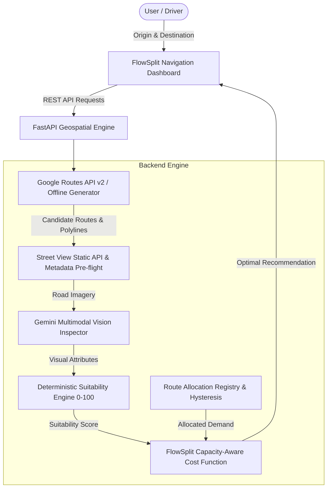

# FlowSplit — Capacity-Aware, AI-Powered Geospatial Routing System

**FlowSplit** is an intelligent full-stack geospatial routing system designed to address **GPS-induced side-street gridlock**. Conventional GPS navigation apps blindly route vehicles onto narrow residential streets to shave off seconds, overwhelming fragile neighborhood corridors and causing gridlock.

FlowSplit solves this by combining **traffic-aware travel time**, **Gemini multimodal road-imagery analysis**, **road-suitability scoring**, **corridor connectivity**, and **capacity-aware route selection**.

---

## 1. System Architecture



---

## 2. Core Technical Innovations

### A. Deterministic Road-Suitability Scoring (0–100)
Rather than blindly relying on subjective model outputs, FlowSplit executes a deterministic scoring formula based on physical and contextual features:
- **Usable Road Width ($w = 0.35$):** Evaluates clear carriageway width; penalizes corridors under vehicle dimensional minimums.
- **Curbside Parking Friction ($w = 0.25$):** Quantifies curbside choke-points and alternating pinch-points.
- **Pedestrian Context ($w = 0.20$):** Protects school zones, vulnerable pedestrian zones, and shared spaces from cut-through traffic.
- **Lane Connectivity ($w = 0.20$):** Rewards multi-lane divided arteries over single shared lanes.
- **Explicit Uncertainty Handling:** Unknown features trigger explicit safety penalties and discount confidence.

### B. Capacity-Aware Route Selection Cost Function
FlowSplit selects routes via a multi-factor objective:
$$\text{route\_cost} = C_{\text{time}} + C_{\text{congestion}} + C_{\text{unsuitable}} + C_{\text{uncertainty}}$$
- **$C_{\text{time}}$:** $\alpha \times \text{traffic\_duration\_seconds}$
- **$C_{\text{unsuitable}}$:** $\beta \times \sum_{\text{seg}} (100 - \text{suitability}_{\text{seg}}) \times \frac{\text{length}_{\text{seg}}}{\text{total\_length}}$
- **$C_{\text{congestion}}$:** $\gamma \times \sum_{\text{seg}} \text{congestion\_penalty}(V_{\text{seg}}, C_{\text{seg}})$ (using Bureau of Public Roads non-linear delay model)
- **$C_{\text{uncertainty}}$:** $\delta \times (1.0 - \text{confidence}_{\text{route}})$

### C. Route Allocation Registry & Hysteresis
Tracks recently recommended routes to prevent oscillating suggestions and prevent concentrated vehicle surges on delicate corridors.

---

## 3. Technology Stack

- **Frontend:**
  - Modern Semantic HTML5 & Vanilla CSS (Dark theme, Glassmorphism, CSS Grid/Flexbox).
  - Dual Map Engine: Google Maps JavaScript API with interactive Canvas/Vector fallback for offline dev.
  - Browser Geolocation API (`navigator.geolocation`) with HTTPS/localhost validation.
- **Backend:**
  - Python 3.12+ with FastAPI.
  - Pydantic v2 validation and Pydantic-Settings.
  - Zero-database in-memory persistence (SQLite disabled, PostgreSQL production-ready).
  - Redis integration supported for distributed caching (optional).
- **AI & Geospatial:**
  - Official `google-genai` Python SDK (`gemini-2.5-flash`).
  - Google Routes API v2 (Traffic-aware computation).
  - Google Street View Static API with pre-flight metadata validation.

---

## 4. Ubuntu Setup & Quickstart

### Step 1: Clone and Create Virtual Environment
```bash
git clone <repo-url> gdg_split
cd gdg_split

# Create and activate Python 3.12+ virtualenv
python3 -m venv .venv
source .venv/bin/activate

# Upgrade pip and install dependencies
pip install -r requirements.txt
```

### Step 2: Configure Environment Variables
Copy the template configuration:
```bash
cp .env.example .env
```

Edit `.env` to supply your online Google Cloud and Gemini credentials:
```ini
GOOGLE_MAPS_BROWSER_KEY=your_browser_key_here
GOOGLE_MAPS_JS_API_URL=https://maps.googleapis.com/maps/api/js

GOOGLE_ROUTES_API_KEY=your_routes_api_server_key_here
GOOGLE_ROUTES_API_URL=https://routes.googleapis.com/directions/v2:computeRoutes

GOOGLE_STREET_VIEW_API_KEY=your_street_view_api_server_key_here
GOOGLE_STREET_VIEW_METADATA_URL=https://maps.googleapis.com/maps/api/streetview/metadata
GOOGLE_STREET_VIEW_IMAGE_URL=https://maps.googleapis.com/maps/api/streetview

GEMINI_API_KEY=your_gemini_api_key_here
GEMINI_MODEL=gemini-2.5-flash
GEMINI_API_URL=https://generativelanguage.googleapis.com

ONLINE_MODE_ONLY=true
```
> **Online-Only Architecture**: The application operates exclusively in online mode using live APIs. Offline demo fallback, predefined synthetic routes, and SQLite have been completely removed.

### Step 3: Run the Application
```bash
source .venv/bin/activate
uvicorn backend.app.main:app --host 0.0.0.0 --port 8000 --reload
```
Open **`http://localhost:8000`** in your browser.

---

## 5. Live Online Routing & Simulation Lab

FlowSplit dynamically evaluates real routes queried from Google Routes API:
1. Enter your origin and destination coordinates (or click **GPS** to acquire your device location).
2. Click **"Evaluate Routes"** to query live routes from Google Routes API.
3. FlowSplit samples road segments, fetches real Street View imagery, and sends imagery to Gemini multimodal vision for physical road suitability scoring.
4. The capacity-aware engine selects the optimal route balancing transit time against fragile neighborhood corridors.

### Launching the Traffic Simulation Lab:
1. In the top navigation bar, click **"Simulation Lab"**.
2. Specify the hourly commuter trip demand (e.g. 900 vehicles).
3. Click **"Run Simulation"**.
4. Observe the capacity distribution across the live evaluated corridor paths.

---

## 6. API Reference

| Method | Endpoint | Description |
|---|---|---|
| `GET` | `/health` | Service health status and active external API capabilities |
| `GET` | `/api/config/public` | Public configuration with server secrets strictly redacted |
| `POST` | `/api/routes/candidates` | Generates candidate routes (Google Routes API or benchmark) |
| `POST` | `/api/routes/analyze` | Runs Gemini vision inspection and suitability scoring |
| `POST` | `/api/routes/select` | Executes FlowSplit capacity-aware route selection |
| `POST` | `/api/roads/analyze` | Inspects a single geographic road coordinate |
| `GET` | `/api/roads/{road_id}` | Retrieves persisted road inspection data and observations |
| `GET` | `/api/routes/analysis/{id}` | Retrieves historical route analysis record |
| `POST` | `/api/simulation/run` | Runs head-to-head Baseline vs FlowSplit BPR traffic simulation |

---

## 7. Security and Cost Controls

- **Strict Key Separation:** The public browser key (`GOOGLE_MAPS_BROWSER_KEY`) is restricted to Maps JavaScript API and HTTP referrers. Server keys (`GOOGLE_ROUTES_API_KEY`, `GOOGLE_STREET_VIEW_API_KEY`, `GEMINI_API_KEY`) are kept on the backend and never exposed in client responses.
- **Pre-flight Metadata Inquiries:** Street View metadata is verified before requesting imagery, preventing billable calls for locations lacking coverage.
- **100m Sampling Bounds & Budgets:** Sampling along routes is bounded by `MAX_IMAGE_BUDGET_PER_ROUTE` (default: 10 images) to enforce strict cost predictability.
- **Safe Error Masking:** Global exception handlers return clean, sanitized JSON error payloads, masking stack traces and internal secrets.

---

## 8. Automated Test Suite

Run the full automated test suite covering deterministic scoring, capacity-aware routing, BPR simulation, security redactions, and API endpoints:
```bash
source .venv/bin/activate
pytest backend/tests -v
```
All 22 unit, integration, and simulation tests run deterministically offline without billable external API calls.
